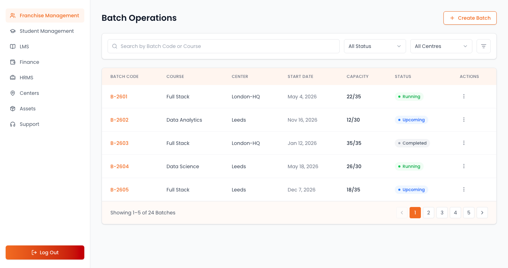

# Batch Operations – Listing, Search & Pagination

A Batch Operations page that lists training batches from a Node.js/Express API. Users can search, filter by status and centre, and page through the results.



## Tech stack

| Part     | Technology                                                       |
| -------- | ---------------------------------------------------------------- |
| Frontend | React 19 (Vite), Axios, Tailwind CSS                             |
| Backend  | Node.js, Express                                                 |
| Data     | Local mock JavaScript array (`backend/data/batches.js`), no database |
| Tests    | Jest + Supertest (backend), Vitest + React Testing Library (frontend) |

## Getting started

**Requirements:** Node.js 20.19 or newer, and npm.

### Option 1: run everything with one command

From the project root:

```bash
npm run setup   # installs root, backend and frontend packages
npm run dev     # starts the API and the web app together
```

Then open **http://localhost:5173**. If that port is busy, Vite picks the next free port and prints it in the terminal.

### Option 2: run the backend and frontend separately

```bash
# Terminal 1: backend API on http://localhost:4000
cd backend
npm install
npm run dev
```

```bash
# Terminal 2: frontend on http://localhost:5173
cd frontend
npm install
npm run dev
```

The frontend calls `/api/...`, and the Vite dev server forwards those requests to `http://localhost:4000`. To run the backend on another port, use `PORT=5000 npm run dev` and update the proxy target in `frontend/vite.config.js`.

### Scripts (run from the project root)

| Command         | What it does                                  |
| --------------- | --------------------------------------------- |
| `npm run setup` | Install all dependencies                      |
| `npm run dev`   | Start backend and frontend together           |
| `npm test`      | Run backend and frontend tests                |
| `npm run lint`  | Lint the frontend                             |
| `npm run build` | Build the frontend for production             |

## Features

- **Batch listing table** with these columns: Batch Code, Course, Center, Start Date, Capacity (enrolled / total), Status (Running / Upcoming / Completed) and Actions.
- **Search** by batch code or course name. Results update as you type, with a short 400 ms delay so the API isn't called on every key press.
- **Filters** by status and by centre, each with an "All Status" / "All Centres" option. Search and both filters work together.
- **Pagination** with 5 records per page:
  - Previous and Next buttons, plus clickable page numbers.
  - Shows the current record range and the total, e.g. "Showing 1–5 of 24 Batches".
  - Changing the search or a filter goes back to page 1.
- **Loading, error and empty states.** A spinner shows while loading, an error message with a Retry button shows when the API fails, and "No batches found" shows when nothing matches.
- **UI-only elements**, as the assignment specifies: the Create Batch button, the Actions (⋮) menu and the sidebar links.
- **Reset filters:** the filter icon next to the dropdowns clears the search and both filters.

## API

All batch operations go through a single GET endpoint with query parameters.

### `GET /api/batches`

| Query param | Default | Description                                         |
| ----------- | ------- | --------------------------------------------------- |
| `page`      | `1`     | Page number (positive whole number)                 |
| `limit`     | `5`     | Records per page (1–50)                             |
| `search`    | –       | Matches batch code or course name (case-insensitive) |
| `status`    | –       | `Running`, `Upcoming` or `Completed`                |
| `centre`    | –       | Centre name, e.g. `London-HQ`                       |

Example:

```
GET /api/batches?page=1&limit=5&search=full stack&status=Running&centre=London-HQ
```

```json
{
  "success": true,
  "data": [
    {
      "id": 1,
      "batchCode": "B-2601",
      "courseName": "Full Stack",
      "centreName": "London-HQ",
      "startDate": "2026-05-04",
      "enrolledStudents": 22,
      "totalCapacity": 35,
      "status": "Running"
    }
  ],
  "pagination": {
    "page": 1,
    "limit": 5,
    "totalRecords": 1,
    "totalPages": 1
  }
}
```

Invalid values return `400`:

```json
{ "success": false, "message": "status must be one of: Running, Upcoming, Completed" }
```

### `GET /api/batches/centres`

Returns the centre names used to fill the "All Centres" dropdown:

```json
{ "success": true, "data": ["Birmingham", "Leeds", "London-HQ", "Manchester"] }
```

### `GET /api/health`

Returns `{ "success": true, "message": "API is running" }`.

Only GET endpoints exist. There are no POST, PUT, PATCH or DELETE endpoints.

## Project structure

```
.
├── backend/
│   ├── controllers/batchController.js    # Reads the request, calls the service, sends JSON
│   ├── routes/batchRoutes.js             # GET /api/batches and /api/batches/centres
│   ├── services/batchService.js          # Search, filter and pagination logic (BatchService class)
│   ├── validators/batchQueryValidator.js # Checks page, limit and status; applies defaults
│   ├── middlewares/errorHandler.js       # 404 and error responses
│   ├── data/batches.js                   # Mock data (24 batches)
│   ├── constants/  utils/
│   ├── app.js                            # Creates the Express app
│   ├── server.js                         # Starts the server
│   └── tests/                            # Service and API tests
│
└── frontend/src/
    ├── components/   # Sidebar, PageHeader, BatchFilters, BatchTable, StatusBadge, Pagination
    ├── pages/        # BatchOperationsPage (search, filter and page state)
    ├── services/     # apiClient (axios) and batchService (BatchService class)
    ├── hooks/        # useBatches, useCentres, useDebounce
    ├── constants/  utils/
    ├── App.jsx       # Layout: sidebar + page
    └── main.jsx
```

### How a request flows

1. The user types a search, picks a filter or clicks a page in `BatchOperationsPage`.
2. The `useBatches` hook calls `batchService.getBatches()`, which sends a request with axios.
3. The request reaches `GET /api/batches`, where `batchRoutes` passes it to `BatchController.getBatches`.
4. The controller validates the query, then `BatchService` filters and paginates the data.
5. The response `{ success, data, pagination }` comes back, and the table and pagination re-render.

If the inputs change before a request finishes, that request is cancelled, so an old response can never overwrite a newer one.

## Testing

```bash
npm test
```

| Suite    | Tests | Covers                                                                 |
| -------- | ----- | ---------------------------------------------------------------------- |
| Backend  | 31    | Search by code and course, status and centre filters, combined filters, pagination pages and totals, empty results, validation errors (400), unknown routes (404) |
| Frontend | 30    | Table columns and data, loading, error and Retry, empty state, search delay, both filters, reset, page 1 reset, Previous/Next/page numbers, record range |

## Notes

- The mock data has 24 batches across 4 centres, with 8 in each status, so pagination has 5 pages.
- Dates are stored as `YYYY-MM-DD` and shown like the UI reference, e.g. "May 4, 2026".
